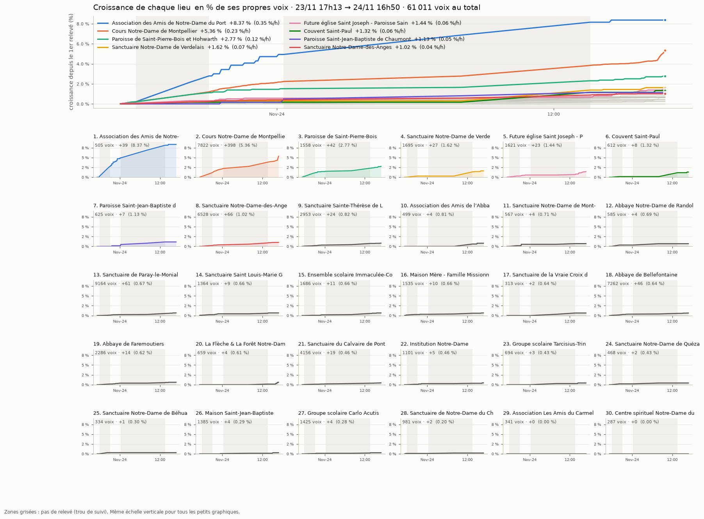
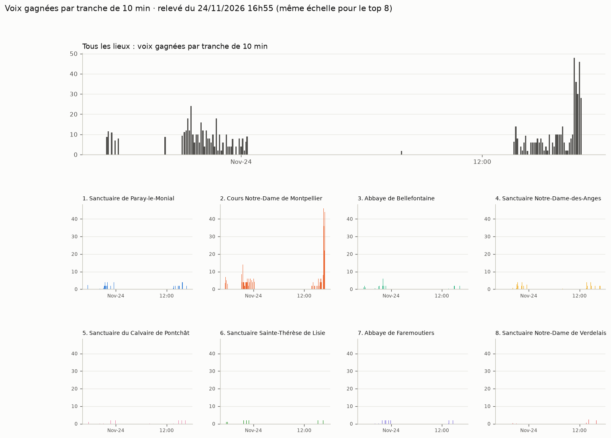

# Suivi des votes vote.soscalvaires.org

**Tableau de bord en ligne : https://matthieu-thomeer.github.io/sos-calvaires/** (actualisé à chaque relevé, toutes les 10 min environ).

Les données sont relevées par GitHub Actions (`.github/workflows/suivi.yml`) et enregistrées dans `votes.csv`. En local : `python dashboard.py` régénère `dashboard.html`.

## Prévision

La carte « Prévision » du tableau de bord projette les voix jusqu'à la clôture du vote (lue sur le site). Le modèle n'est pas linéaire : le débit de chaque lieu vaut **(fond + boost amorti) × cycle jour/nuit**, soit `dN/dt = (r0 + A·e^(−t/τ))·(1 + a·cos(2π(h − φ)/24))`. Le boost représente l'effet d'un appel au vote qui retombe (demi-vie τ·ln 2). Le cycle jour/nuit est commun à tous les lieux et mesuré sur le total. L'ajustement porte sur les voix gagnées entre deux relevés (vraisemblance de Poisson), et la fourchette 10–90 % tient compte de l'incertitude des paramètres et du hasard des votes. Un nouvel appel au vote n'est pas prévisible et sort donc de la fourchette.

Un test rétrospectif refait le calcul sans les dernières heures et compare le modèle à la projection linéaire, pour savoir lequel croire. En local : `python prevision.py` affiche le bilan. Pour forcer une autre date de fin : `SOS_FIN_VOTE=2026-11-30T23:59 python prevision.py`.

