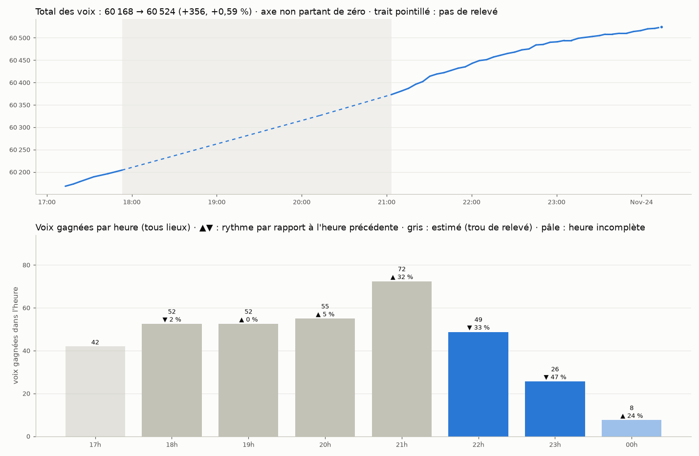
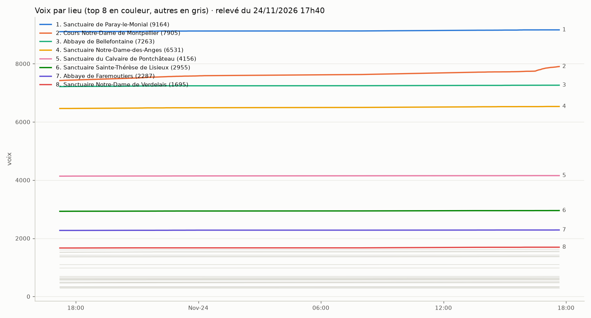

# Suivi des votes vote.soscalvaires.org

**Tableau de bord en ligne : https://matthieu-thomeer.github.io/sos-calvaires/** (actualisé à chaque relevé, toutes les 10 min environ).

Les données sont relevées par GitHub Actions (`.github/workflows/suivi.yml`) et enregistrées dans `votes.csv`. En local : `python dashboard.py` régénère `dashboard.html`.

